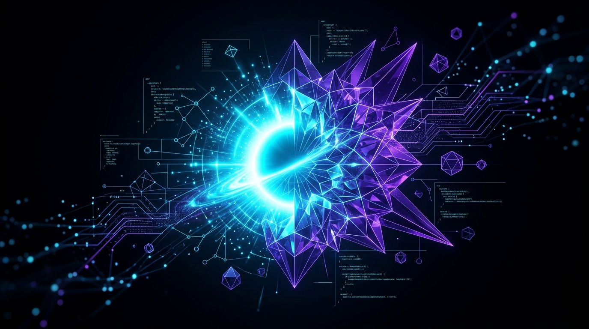

<div align="center">



# ⚡ Antigravity to Claude Code
### *وأخيراً... الدستور الذي يجعل Google Antigravity بمستوى Claude Code*
**The Battle-Tested Software Engineering Constitution & Swarm Governance Protocol that elevates Google Antigravity (AGY), Cursor, and Copilot to Claude Code Performance.**

[](https://opensource.org/licenses/MIT)
[](https://github.com/google-deepmind)
[](https://anthropic.com)
[](#)
[](#)

---

[English Overview](#-english-overview) • [المقدمة بالعربية](#-نبذة-عن-المشروع) • [The 8 Code Invariants](#-the-8-code-invariants) • [Swarm Governance](#-swarm-governance) • [Before vs After](#-before-vs-after-the-empirical-proof) • [Quickstart](#-quickstart--installation)

---

</div>

## 📖 نبذة عن المشروع (Overview)

معظم مطوري الذكاء الاصطناعي يعانون من مشكلة متكررة:
> *"الوكيل البرمجي يهلوس، يترك متغيرات غير معرّفة، يكسر دوال سابقة عند التعديل، ويخفي الأخطاء بـ `try/catch` صامت!"*

بينما تتفوق **Claude Code** التابعة لـ Anthropic بفضل **دستور برمجي صارم وهندسة أسراب فائقة**، تم تفكيك هذه الأسرار المعمارية من الشفرات الثنائية (Binary Decompilation لـ Claude Code v2.1.306) ودمجها مع أصول **أندريه كارباتي (Karpathy)** و **جون أوسترهوت (APOSD)** لإنشاء هذا الدستور الموحد.

هذا المشروع يمنح **Google Antigravity (AGY)** و **Cursor** نفس العقلية الصارمة، مما يرفع دقة الكود بنسبة 100% ويمنع الانتكاسات البرمجية.

---

## ⚡ The 8 Sovereign Code Invariants (Part I)

Language-agnostic constraints governing the Abstract Syntax Tree (AST) across Python, Go, Rust, TypeScript, and C/C++:

| Invariant | Name | The Strict Rule |
| :--- | :--- | :--- |
| **INVARIANT 1** | **Zero-Unbound State** | NEVER assign variables inside branching (`if`/`match`/`try`) without outer-scope safe defaults (`None`, `0`, `""`, `[]`, `nil`). Exhaustive `else` fallback required. |
| **INVARIANT 2** | **Defensive Access** | Verify existence before indexing (`obj.attr`, `data["key"]`, `arr[0]`) using safe primitives (`.get()`, `?.`, nil checks). |
| **INVARIANT 3** | **Net-Negative Diffs** | Prioritize **Delete > Replace > Add**. Three-Line Rule: 3 similar lines > premature abstraction. Zero unrequested helpers. |
| **INVARIANT 4** | **Zero Comments Philosophy** | Default ZERO comments. Write comments ONLY for non-obvious WHY (hidden constraints, hardware bugs). Never explain WHAT code does. |
| **INVARIANT 5** | **Anti-Masking & Fail-Fast** | Validate contracts ONLY at external system boundaries (network, I/O). Trust internal code. NEVER mask bugs with silent null/try-except fallbacks; fail fast. |
| **INVARIANT 6** | **Blast Radius & Surgical Edits** | Reversible actions run freely. Destructive actions (`rm -rf`, `reset --hard`) require confirmation. Never use `git add .` blindly. |
| **INVARIANT 7** | **Removed-Behavior Auditor** | Before deleting code lines, audit what invariant they enforced. First sentence must state any failure. Fabricated outcomes are bugs. |
| **INVARIANT 8** | **Mandatory Pre-Flight Gate** | Run silent background syntax checks (`python3 -m py_compile`, `node --check`, `tsc --noEmit`, `cargo check`) before reporting done. |

---

## 🐝 Swarm Governance & Subagent Orchestration (Part II)

Extracted directly from Claude Code v2.1.306 subagent harness mechanics:

* **`SWARM 1 (Never Delegate Understanding)`**: The orchestrator must prove understanding before delegating. Specify exact file paths, line ranges, and target AST conditions. Never say *"investigate and fix based on findings"*.
* **`SWARM 2 (Workspace Isolation)`**: Heavy multi-file edits by subagents MUST use `share` (Git Worktree / `tengu_worktree_mode`) or `branch` workspace mode to eliminate merge conflicts.
* **`SWARM 3 (Conclusion-Only Handback)`**: Subagents absorb thousands of lines but return only the distilled technical findings + exactly **ONE sentence summary** for the user. Zero raw file dumps into parent context.
* **`SWARM 4 (Delegation Restraint)`**: Tasks touching fewer than 3 files are executed inline. Low spawn counts; never duplicate delegated searches.

---

## 🔬 Before vs After: The Empirical Proof

### ❌ The Classical AI Defect (Vulnerable Code):
```python
# The AI agent writes this branching logic:
def process_batch(items, threshold=10):
    if len(items) > threshold:
        status = 200
        msg = "Batch limit exceeded"
    elif len(items) == 0:
        status = 204
    # If 0 < len(items) <= threshold -> CRASH: UnboundLocalError: status
    
    # Late-binding loop closure trap:
    callbacks = [lambda: i * 2 for i in range(len(items))]  # All return final i!
    
    # Silent masking hiding architectural defect:
    try:
        critical_metric = 100 / (len(items) - 5)
    except Exception:
        critical_metric = None  # Silent failure propagates downstream!
```

### ✅ The Sovereign Constitution Invariant:
```python
def process_batch(items, threshold=10):
    # INVARIANT 1: Zero-Unbound State with safe outer defaults
    status = 0
    msg = ""
    if len(items) > threshold:
        status = 200
        msg = "Batch limit exceeded"
    elif len(items) == 0:
        status = 204
        msg = "Empty batch"
    else:
        status = 200
        msg = "Batch processed"
    
    # Early-binding closure:
    callbacks = [lambda i=i: i * 2 for i in range(len(items))]
    
    # INVARIANT 5: Anti-Masking (Fail-Fast):
    if len(items) == 5:
        raise ZeroDivisionError("Batch size cannot be exactly 5")
    critical_metric = 100 / (len(items) - 5)
```

---

## 🚀 Quickstart & Installation

This repository offers drop-in configuration files for your favorite agentic tools:

### 1. For Google Antigravity (AGY / Gemini CLI):
Place `AGENTS.md` in your home directory or workspace root:
```bash
curl -fsSL https://raw.githubusercontent.com/medmera2008-sys/antigravity-to-claude-code/main/AGENTS.md -o ~/AGENTS.md
```

### 2. For Claude Code:
Place `CLAUDE.md` in your project root:
```bash
curl -fsSL https://raw.githubusercontent.com/medmera2008-sys/antigravity-to-claude-code/main/CLAUDE.md -o ./CLAUDE.md
```

### 3. For Cursor:
Place `.cursorrules` in your project root:
```bash
curl -fsSL https://raw.githubusercontent.com/medmera2008-sys/antigravity-to-claude-code/main/.cursorrules -o ./.cursorrules
```

---

## ⚖️ License
Released under the permissive [MIT License](LICENSE).
Built with sovereign software engineering principles for developers who demand deterministic zero-defect code.
